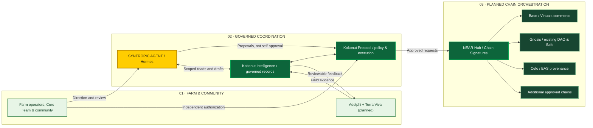

import { KokonutSyntropicHero, KokonutSyntropicDiagramFrame, KokonutSyntropicExperience } from '/snippets/kokonut-syntropic-agent.jsx';
import { KokonutSiteFooter } from '/snippets/kokonut-footer.jsx';

<main className="ksa-root">

<KokonutSyntropicHero />

<KokonutSyntropicDiagramFrame>

</KokonutSyntropicDiagramFrame>

<KokonutSyntropicExperience />

</main>

<KokonutSiteFooter />
